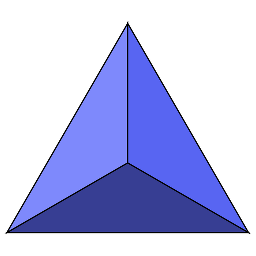

# Panes



A Windows-style desktop that opens in an `about:blank` window from a single bookmarklet: sign-in
screen, windows, taskbar and Start menu, with four apps: **Mist** (the game store and library),
**Concord** (chat), **Gleam** (web browser) and **Settings**. Everything is served from this GitHub
repo (the repo keeps its old name, EaglercraftLauncher, so existing bookmarks keep working).
The bookmark page is `/getpanes` on the server (the old `/getmist` still works).

```
eaglercraft-launcher/
├── loader.js          ← the bookmarklet loads this; set your repo here
├── versions.json      ← the list of versions the launcher shows
├── bookmarklet.txt    ← the one-line bookmark
├── launcher/
│   ├── index.html     ← launcher layout
│   ├── style.css      ← launcher look
│   ├── shell.js/.css  ← the Mist desktop (sign-in screen, windows, taskbar, Start)
│   ├── concord.js     ← Concord (chat app)
│   ├── gleam.js       ← Gleam (web browser app)
│   ├── settingsapp.js ← Settings app
│   ├── sync.js        ← cloud saves (world snapshot + sync)
│   └── app.js         ← launcher logic (download, cache, launch, accounts)
├── versions/          ← put your Eaglercraft .html builds here
└── server/            ← cloud save server (runs on your own machine, NOT GitHub)
    ├── server.js
    ├── package.json
    └── eaglercraft-saves.service
```

## Install page

The save server also serves this page at https://mistserver.space/getmist (its front page,
https://mistserver.space/, is Grant Canyon from `sites/grantcanyon/`). Copy `docs/` into the server's
`public/` folder and `sites/grantcanyon/` into `public/grantcanyon/`, or just run
`sh server/grantcanyon-setup.sh` on the server, which does both and restarts it.
`docs/mist-qr.png` points to /getmist; `docs/mist-qr-github.png` points to the GitHub Pages copy.

`docs/index.html` is a page that installs the bookmarklet (drag-to-bookmarks button plus copy code),
and `docs/mist-qr.png` is a QR code that opens it. Turn on GitHub Pages once
(Settings → Pages → Deploy from a branch → `main` / `/docs`) and it's live at
https://th3nu8.github.io/EaglercraftLauncher/. Pages only publishes `docs/`, so the big game files
in `versions/` don't count toward its size limit.

## Setup

1. **Create a public GitHub repo**, e.g. `eaglercraft-launcher`, and push
   everything in this folder to the `main` branch.
2. **Edit `loader.js`**: set `REPO` to your username / repo / branch.
3. **Add your versions**: put each offline single-file build in `versions/`
   and list it in `versions.json` (see below).
4. **Edit `bookmarklet.txt`**: change `th3nu8/eaglercraft-launcher@main` to your
   `user/repo@branch`.
5. **Make the bookmark**: create a new bookmark, paste the whole line from
   `bookmarklet.txt` as the URL, and name it whatever you like.
6. Go to any normal web page and click the bookmark. The launcher opens in a new
   `about:blank` tab.

## Cloud saves (sign in to keep worlds on any site)

Browsers keep Eaglercraft worlds separately for each website, so a world made
while launching from one site isn't visible from another. Signing in fixes that:
the launcher backs up your worlds to your own save server and restores them on
whichever site you open it from.

### 1. Run the save server (on Sandpile)

It's a single Node 18+ file with no dependencies.

```bash
sudo mkdir -p /opt/eaglercraft-saves
sudo cp server/server.js server/merge-data.js server/package.json /opt/eaglercraft-saves/
sudo mkdir -p /opt/eaglercraft-saves/public/grantcanyon && sudo cp docs/* /opt/eaglercraft-saves/public/
sudo cp -r sites/grantcanyon/. /opt/eaglercraft-saves/public/grantcanyon/
sudo mkdir -p /opt/eaglercraft-saves/data && sudo chown -R www-data:www-data /opt/eaglercraft-saves
sudo cp server/eaglercraft-saves.service /etc/systemd/system/
sudo systemctl daemon-reload && sudo systemctl enable --now eaglercraft-saves
curl http://127.0.0.1:3100/api/health     # → {"ok":true,...}
```

It listens on `127.0.0.1:3100` by default. Settings are environment variables in the
service file:

| Variable        | Default        | Meaning |
|-----------------|----------------|---------|
| `PORT`          | `3100`         | Port to listen on. |
| `HOST`          | `127.0.0.1`    | Keep it local and expose it through the tunnel. |
| `DATA_DIR`      | `./data`       | Where accounts (`db.json`) and saves (`saves/`) live. **Back this folder up.** |
| `MAX_SAVE_MB`   | `256`          | Largest save upload allowed per account. |
| `ALLOW_SIGNUPS` | `true`         | Set `false` once your people have accounts. |
| `SESSION_DAYS`  | `180`          | How long a sign-in lasts. |
| `PUBLIC_DIR`    | `./public`     | Website: `/` serves `grantcanyon/index.html` (copy of `sites/grantcanyon/`), `/getmist` serves `index.html` (copy of the repo's `docs/`). |
| `ASSETS_DIR`    | `./assets`     | Game asset packs served at `/assets/<name>`. Counter Attack downloads `csattack.zip` from here (a zip containing `cstrike/` and `valve/` folders). Replace the file to push an update; players re-download only when it changes. |

### 2. Give it an HTTPS address

The launcher runs on HTTPS pages, so the server needs HTTPS too. With Cloudflare
Tunnel, add an ingress rule such as:

```yaml
- hostname: eaglersaves.noobscloud.org
  service: http://127.0.0.1:3100
```

then `cloudflared tunnel route dns <tunnel> eaglersaves.noobscloud.org` and restart
cloudflared.

### 3. Point the launcher at it

Set `"syncServer"` at the top of `versions.json`:

```json
{ "syncServer": "https://eaglersaves.noobscloud.org", "versions": [ ... ] }
```

(Players can also override it in **Settings → Save server**.)

### Friends & chat

Friends use the same server and accounts as cloud saves, so there's nothing extra to set up,
just run the updated `server/server.js`.

- **Add a friend:** Friends & Chat → ＋ → their account name. They get a request with ✓ / ✕.
- **Status:** friends show as *In-game* ("Playing Polytrack"), *Online* (launcher open) or
  *Offline* ("Last online 2 h ago"). Status is only visible to friends.
- **Chat:** click a friend. Messages are friends-only, up to 500 characters, and the last 300
  per conversation are kept. New messages and requests pop up a notification and a red badge.
- **Profiles:** click any name or your own to see member-since, friend count and recently played games.
- Limits: 300 friends, 100 pending requests, 30 messages a minute per person.

### Achievements & stats

The server tracks playtime (from the "Playing X" status Mist sends every minute while a game is
open in "Inside launcher" mode), games played, days active and streaks, friends, chat messages and
cloud saves. 20 achievements unlock from those, like *First Steps* (10 min played), *Explorer*
(5 games), *Squad Up* (5 friends), *Weekly Warrior* (7-day streak) and *Mist Legend* (100 hours).
Unlocks pop up in the top-right, even over a running game. Profiles show stats and badges, your own
profile shows progress bars, and the Users page shows each player's trophy count and playtime.
The list lives in `ACHIEVEMENTS` in `server/server.js`, so adding one is a single line.

### Profiles & game achievements

Click any player name (Users page, friends list, chat, store) or **My profile & achievements**
in the account menu to open a full profile page:
- header with avatar, status (friends only) and Add friend / Message buttons
- stats: playtime, games, achievements, game badges, best streak, days active
- every achievement with unlock date, **rarity** (% of players who have it) and, on your own
  profile, progress bars; filter All / Unlocked / Locked
- **Game achievements**: every game has 7 for time played (🌱 5 min, 🎈 15 min, 🎯 30 min, 🪝 1 h,
  🎮 2 h, 💪 5 h, 🛡️ 10 h), and many games also have their own achievements read from the game's
  save while it runs (levels beaten, best scores, ranks, medals...). Click a game to see them all.
- recently played games and friends (visible to you and your friends)

### Achievements page, rarity and levels

**ACHIEVEMENTS** in the top bar lists every achievement with its goal: a General tab (20) and a
Game achievements tab with every game (search, sort, click a game for its list).

Each achievement has a rarity worth XP: **Common 100 · Rare 250 · Epic 500 · Legendary 1,000**.
XP adds up to a level from 0 to **50**; level 50 means everything is unlocked (the curve rescales
itself when achievements are added). Your level shows in the top bar, on profiles and on the
Users page, and a pop-up appears when you level up.

### Adding achievements for a game

Game-specific achievements only work in **Inside launcher** mode, while signed in. Most games are
described in `tools/game-achievements.json`:

```json
"Some Game": {
  "spec": { "src": "ls", "key": "someGameSave", "stats": { "level": "progress.level", "wins": "stats.wins" } },
  "ach": [["l10", "🏁", "Getting Going", "Reach level 10.", "level", 10, "common"]]
}
```

- `src`: `ls` (localStorage), `flash` (Ruffle SharedObject, only saves written while the game runs
  count), `prefs` (Unity PlayerPrefs), `lf` (localforage / Construct 3 storage, set `db`), `idbfile`
  (a file in an engine's IndexedDB file system). `key` is a name or `/regex/`; `session: true`
  only counts saves changed while the game runs (for games that share key names).
- a stat is a path into the save, with optional `|len`, `|true`, `|bool`, `|sum`, `|tot`, `|cnt`,
  `|cntge:N`, `|ge:N`, `|keys:RE`, `|truekeys:RE`, `|keymax:RE`, `|csv`. `*` steps into every entry.
- then run `node tools/build-achievements.js`, which writes `launcher/specs.js` and the matching block
  in `server/server.js` (update the server afterwards). Odd formats have hand-written readers in
  `launcher/hooks.js`.

### If accounts go missing

The server now protects against the two ways accounts used to get lost:
- It **won't start** if it can't write its data folder, and prints the `chown` command to fix it.
- Only **one server per data folder**: a second copy refuses to start instead of fighting over the data.
- If saving fails while running, it retries, shows `"storage":"error"` on `/api/health`, and refuses
  sign-ups instead of accepting accounts that would vanish on restart.
- `db.json` is **backed up** to `data/backups/` on every start and every 6 hours (newest 28 kept).
- The log's first line says which data folder is in use and how many accounts it has.

To pull accounts back from another data folder (e.g. one a manually started copy was using):
```bash
sudo systemctl stop eaglercraft-saves
sudo node /opt/eaglercraft-saves/merge-data.js /path/to/other/data /opt/eaglercraft-saves/data
sudo chown -R www-data:www-data /opt/eaglercraft-saves/data
sudo systemctl start eaglercraft-saves
```

### How syncing works

- Click the profile box at the top of the sidebar to **create an account or sign in**.
  You sign in once per site; after that it remembers you there.
- **Pressing Play** syncs first: if the cloud has newer worlds, they're loaded
  before the game starts.
- **While you play** (inside-launcher mode), changes are backed up every 3 minutes
  and when you switch tabs. **Returning to the launcher** backs up immediately.
- If two sites both changed worlds since their last sync (e.g. you played on two
  sites at once), the launcher asks which copy to keep, with an option to export a
  backup file first. Nothing is overwritten without asking.
- **Settings → Backup file** exports or imports a `.eglsave` file, with or without an account.
- In "Replace page" launch mode the launcher isn't running during play, so your
  worlds are backed up the next time you open the launcher on that site.
- The server keeps the previous upload as `saves/<user-id>.bin.prev` as a safety net.

What gets synced: every IndexedDB database on the site whose name contains
"eagler" (worlds, profile, servers list; resource packs are skipped because they're
large), plus `localStorage` keys containing "eagler" (game settings). If a version
uses other database names, list them in that version's `"databases": ["name"]`.

### The Panes desktop

Panes opens as a desktop, like Windows, in dark mode by default:

- **Sign-in screen**: shows a clock. Click or press a key to sign in, create an account or
  **Continue as guest**. Guests can browse and play installed games. Concord and Gleam ask them to sign in.
  **Lock** in Start's power menu returns to it.
- **Windows**: every app and every game opens in a window you can drag by its title bar, resize from any
  edge or corner, snap (drag to the top to maximise, to a side for half the screen), minimise to the
  taskbar, maximise, make full screen (the ⛶ button; Esc leaves) and close. Double-clicking the title
  bar maximises.
- **Taskbar and Start**: pinned apps, running windows, unread badges, server status, clock and
  notifications. Start searches apps and your installed games, and can search the web in Gleam.
- **Desktop**: app icons plus a shortcut for every installed game. Drag them anywhere. Right-click for
  options.

The only apps are:

| App | What it does |
| --- | --- |
| **Mist** | The store and library. Install games here; they appear on the desktop and in Start. |
| **Concord** | Chat. Everyone is in the Mist Lounge. You can make your own servers with channels, invite friends with a code, and send DMs (the same messages as Mist's friends chat), all live. It also handles friends, mentions, replies, edits and server admin roles, kicks and bans. |
| **Gleam** | The web browser: tabs, back/forward, address bar, through the Mist server (see below). |
| **Settings** | Themes that make Panes look like Windows 1.0, 3.1, 95, 98, Me, 2000, XP, Vista, 7, 8, 10 and 11, Mac OS 9, Mac OS X Aqua, macOS, Ubuntu, GNOME or KDE Plasma (windows, buttons, taskbar or dock, Start, fonts and wallpaper); light/dark mode, accent colour, wallpaper (8 built-in, a solid colour, a gradient, your own photo or an image link), lock screen picture, transparency, animations, corners, size, taskbar position and alignment, auto-hide, clock, pinned apps, desktop icons, notifications, account, plus Mist's game and cloud-save settings. |

Everyone is automatically friends with the owner account **Th3Nu8** (set `OWNER_FRIEND=name` in the
server's environment to change it, or `OWNER_FRIEND=` to turn it off), so the owner can message anyone.
That friendship can't be removed and doesn't count towards friend achievements.

Personalisation is saved to your account (`/api/prefs` on the Mist server), so it follows you to any
computer. Guests' settings stay on that device.

### Gleam (web browser)

Gleam opens websites through the Mist server (Ultraviolet in the page, a wisp relay on the
server). Only signed-in players can open tabs: Mist asks the server for a 12-hour browser ticket, and the
relay refuses connections without a valid one.

Install or update it on the server (also updates the Mist server, which hands out the tickets):

```sh
cd ~/EaglercraftLauncher && git pull && sh server/browser-setup.sh
```

This runs `server/browser` as the `mist-browser` service on 127.0.0.1:3300 and serves it at `/browse/`
(through nginx, and through the Mist server for the tunnel). Rules it applies:

- **Signed in only.** Banning a player, or the **Browser off** button in the admin dashboard, ends their tickets and open tabs.
- **Blocklist** in `/opt/mist-browser/data/blocklist.txt` (one domain per line, re-read every 30 seconds). DNS goes through Cloudflare's family filter (1.1.1.3), which already drops adult and malware sites.
- **Logs**: `/opt/mist-browser/data/logs/YYYY-MM-DD.log` lists which account opened which site (one line per player, site and 10 minutes), kept 30 days (`LOG_DAYS`).
- **Transport**: tabs use libcurl (handles header-heavy sites like YouTube) and retry a site with epoxy when libcurl's TLS can't connect to it ("error code 35"). `TRANSPORT=libcurl` or `TRANSPORT=epoxy` in the service forces one.
- When a page fails, the tab asks the relay why and says so plainly: blocked, filtered by the family DNS, no such site, data limit used up, or site down.
- **Data limit** per player per day: `DAILY_MB` in the service (2048 by default, 0 for none).
- Only ports 80 and 443, no IP addresses and nothing on the server's own network, so it can't be used to reach the server's other services.

Everything people browse leaves from the server's IP address, so abuse reports for those sites come to
the server's host. Some sites (Google sign-in, sites behind heavy bot protection) won't work through it.
`cd server/browser && npm install && npm test` checks tickets, the relay, the blocklist, logs and the admin switch.

### GTA 5 at /gta5 on every domain

The GTA 5 server (`serve_https.py`/`serve_local.py`, on port 8080 or 8001) is reachable as `/gta5` on every
domain pointed at the server's IP, and on the IP itself, with no port in the address:

```sh
cd ~/EaglercraftLauncher && git pull && sh server/gta5-setup.sh
```

It adds `include snippets/mist-gta5.conf;` to every nginx server block (old copies are kept in
`/root/nginx-before-gta5`) and updates the Mist server, which finds the game on 8080/8001 (http or https),
sends root-path requests from the game's pages to the game, and rewrites `host:8080` links and redirects
to `/gta5`. HTTPS on a domain needs a certificate for that domain (or Cloudflare's proxy in front of it).

### Mist PC (stream your own PC into Mist, supporters only)

The **MY PC** page lets Mist Supporters play what's on their own computer from any device Mist runs on
(a Chromebook, a school laptop...). The PC runs **Mist PC** (`pc/mistpc.py`, built into `MistPC.exe` by the
GitHub Action in `.github/workflows/mistpc.yml` and published as the `mistpc` release). It opens a small window
in Chrome/Edge that shares the screen and sound over WebRTC, and presses the viewer's mouse and keyboard on the PC.

- Pairing: MY PC → **Add a PC** shows a one-time code (10 minutes); typing it into Mist PC links that PC to the
  account. Only that account can connect, and only while it's a supporter.
- The Mist server only passes connection messages (long polling through the tunnel); video goes directly between
  the PC and the viewer, or through the TURN relay when a network blocks direct connections.
- The Mist PC window shows when someone's connected, and can disconnect them or block the mouse and keyboard.

Set up the server side (updates the Mist server, publishes `/pc/`, installs the coturn relay on UDP/TCP 3478
and UDP 50000-50999 — open those in ZAP-Hosting's firewall if it has one):

```sh
cd ~/EaglercraftLauncher && git pull && sh server/pc-setup.sh
```

## versions.json

```json
{
  "versions": [
    {
      "id": "1.8.8",
      "name": "Eaglercraft 1.8.8",
      "type": "release",
      "file": "eaglercraft-1.8.8.html",
      "description": "Shown under the title on the Play screen.",
      "notes": ["Bullet points for the Patch Notes tab"],
      "sizeMB": 14,
      "rev": "1"
    }
  ]
}
```

| Field         | Required | What it does |
|---------------|----------|--------------|
| `id`          | yes      | Unique ID (also shown as the version number). |
| `name`        | yes      | Display name. |
| `file`        | yes      | File name inside `versions/`, **or** a full `https://` URL to a file hosted elsewhere (that host must allow CORS). |
| `type`        | no       | `release`, `old_beta`, `old_alpha`, `snapshot` or `modded`. Betas, alphas and snapshots hide when “Show betas” is unticked. |
| `description` | no       | Subtitle on the Play screen and in Installations. |
| `notes`       | no       | List of strings for the Patch Notes tab. |
| `sizeMB`      | no       | Used for the progress bar if the server doesn't send a file size. |
| `rev`         | no       | Change this when you replace a version's file, so players re-download it instead of using their cached copy. |
| `databases`   | no       | Extra IndexedDB names to include in cloud saves (only needed if they don't contain "eagler"). |

## How it works

- **Bookmarklet** opens an `about:blank` tab and loads `loader.js` from jsDelivr
  (jsDelivr serves it with a JavaScript content type; raw GitHub does not).
- **loader.js** fetches the launcher's HTML, CSS, JS and `versions.json` from
  `raw.githubusercontent.com` and writes them into the blank tab. Launcher
  updates show up within a few minutes of a push.
- **Pressing Play** downloads the version's HTML with a progress bar, stores it
  with the browser's Cache API, then runs it in a full-window frame. Later
  launches open instantly from the cache.
- **◀ Launcher** tab at the top of the screen takes you back (press Esc in-game
  first to free the mouse). Settings has a “Replace page” mode that runs the game
  as the whole tab instead.
- **Open local .html** in the sidebar launches a build from your computer
  without uploading it, which is handy for testing.

## Notes and gotchas

- **Use offline single-file builds.** The launcher expects one self-contained
  `.html` per version (the “offline download” builds). Builds split into
  `classes.js` + `assets.epk` won't work as-is.
- **Don't use Git LFS** for the version files; raw GitHub would return the LFS
  pointer instead of the file. Normal commits are fine up to 100 MB per file.
- **Some sites block bookmarklets.** Pages with a strict Content Security Policy
  (GitHub, Google search and similar) stop the bookmark from loading scripts. The
  tab will say so. Click the bookmark on a simpler page instead.
- **Without an account, saves are tied to the site you clicked the bookmark on.**
  The blank tab shares storage with the page that opened it. Sign in (see Cloud
  saves) to carry worlds between sites.
- **The save server must be reachable from the page.** A few sites restrict which
  servers their pages may talk to; on those, the launcher plays with local saves
  and says cloud saves are unavailable.
- **jsDelivr caches `loader.js`** for up to 12 hours (this update changed it, so purge once after pushing). If you change it, purge it at
  `https://purge.jsdelivr.net/gh/<user>/<repo>@main/loader.js`. Changes to
  everything else apply within a few minutes.
- **Bookmarklets can't run on the browser's new-tab page** or on `chrome://` pages.


## Mist Supporter ($5/month through PayPal)

Supporters get a gold avatar outline, 23 extra avatars and the Mist Supporter achievement (+2,500 XP while subscribed).
Mist asks on every 5th game launch (never for supporters) and from the account menu (💛 Support Mist).

Setup on the server: create a PayPal Business account, then a REST app at developer.paypal.com (Live). Put its keys in
`/opt/eaglercraft-saves/paypal.json` and restart the service:

```json
{ "clientId": "YOUR_CLIENT_ID", "secret": "YOUR_SECRET", "mode": "live" }
```

The server creates the $5/month plan on first use, tags each subscription with the player's account, and checks it with
PayPal when they subscribe and every 3 hours. Perks stop when a cancelled or unpaid subscription's paid month runs out.
Use `"mode": "sandbox"` with sandbox keys to test without real money.

## Counter Attack (bring your own files)

`versions/csattack.html` runs Counter-Strike 1.6 on the open-source Xash3D FWGS engine (loaded from jsDelivr), using a zip
of the player's **own** `cstrike` + `valve` folders that they choose on their device. The zip is kept in that browser's
storage only; nothing is uploaded to the server or the repo, and no game files are hosted by Mist.

## PolyTrack leaderboards (Mist only)

Games with `"mistLeaderboards": true` (PolyTrack) get a small script that sends their online leaderboard requests
(`vps.kodub.com/v6/leaderboard`, `leaderboardUserEntry`, `recordings`, `user`) to the Mist server (`/pt/v6/...`) instead,
so the in-game leaderboards list Mist players only, under their Mist names. The game gets a PolyTrack-only token
(`/api/polytrack/token`), never the player's Mist sign-in. Players must be signed in to Mist for times to upload.
Times are sanity-checked but replays aren't re-simulated like on the official server. Track of the Week and
multiplayer are untouched.
